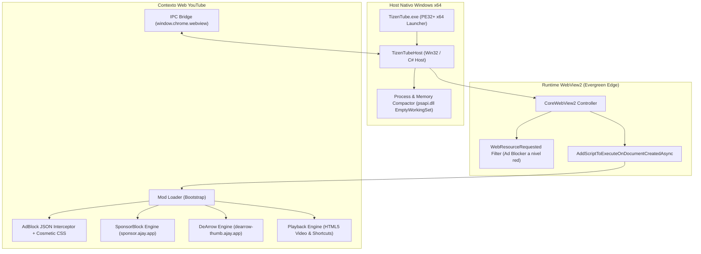

# Arquitectura de TizenTube Windows

Este documento define la arquitectura técnica del cliente de escritorio TizenTube para Windows x64, diseñado específicamente para garantizar reproducción estable de YouTube con bajo consumo de memoria RAM, bloqueo de publicidad multinivel, SponsorBlock y DeArrow.

---

## 1. Principios de Diseño

1. **Eficiencia Extrema de Recursos (RAM y CPU)**: A diferencia de aplicaciones empaquetadas con Electron (cuyo Working Set habitual supera 350–600 MB en reposo), TizenTube Windows se basa en el runtime nativo **Microsoft Edge WebView2 (Evergreen)** preinstalado en Windows 10 (1803+) y Windows 11. Esto elimina el empaquetado redundante de Chromium, comparte librerías del sistema y permite controlar los límites de procesos.
2. **Aislamiento y Seguridad**: Cero almacenamiento o interceptación de credenciales privadas. Se respetan los límites de autenticación estándar de Google y no se falsifican tokens ni identidades.
3. **Resiliencia Frente a Fallos Externos (Fail-Open)**: Caídas o latencias en las APIs de terceros (SponsorBlock o DeArrow) jamás deben congelar, interrumpir ni degradar la reproducción de vídeo.
4. **Reproducibilidad Determinista**: El binario ejecutable x64 y los paquetes de distribución se construyen sin depender de descargas en tiempo de compilación y generan un SHA-256 verificable.

---

## 2. Diagrama de Arquitectura



---

## 3. Modelo de Procesos y Gestión de Memoria

### 3.1 Topología de Procesos
En una aplicación WebView2 típica, Chromium crea múltiples procesos (`browser`, `gpu-process`, `utility`, y múltiples `renderer` por pestaña/iframe).
TizenTube Windows impone restricciones estrictas mediante flags de Chromium configurados al inicializar el entorno:

- `--renderer-process-limit=1`: Fuerza a Chromium a reutilizar un único proceso renderizador para todo el contenido de la aplicación, evitando la fragmentación y duplicación de memoria en sub-frames y navegación interna.
- `--disable-features=Translate,OptimizationHints,MediaRouter,CalculateNativeWinOcclusion,InterestFeedContentSuggestions`: Deshabilita servicios de telemetría y tareas de fondo de Google que consumen hilos y memoria.
- `--enable-features=VaapiVideoDecoder,PlatformHEVCDecoderSupport`: Fuerza la aceleración por hardware de vídeo en la GPU, liberando al procesador y reduciendo drásticamente el consumo de CPU en reproducciones 1080p y 4K.
- `--disk-cache-size=104857600` y `--media-cache-size=104857600`: Limita el tamaño de caché en disco a 100 MB, previniendo el crecimiento desmedido en sesiones largas.

### 3.2 Compactación Activa de Memoria (Working Set Trimming)
El proceso host nativo implementa un temporizador periódico (cada 30 segundos) y un callback en el evento de minimizado de ventana que invoca la API Win32:
```csharp
[DllImport("psapi.dll")]
private static extern bool EmptyWorkingSet(IntPtr hProcess);
```
Esto libera páginas de memoria no activas tanto del proceso host como de los procesos hijos `msedgewebview2.exe`, devolviendo páginas físicas al sistema operativo sin provocar parpadeos ni desconexión del pipeline multimedia.

> [!NOTE]
> **Diferencia entre Working Set y Memoria Privada**: La API `EmptyWorkingSet` transfiere páginas físicas al archivo de paginación (`pagefile.sys`), reduciendo el *Working Set* aparente inmediato, pero **no reduce por sí sola los bytes privados comprometidos** (*Private Bytes* / `PrivateMemorySize64`). Por ello, la optimización estructural real se fundamenta en `--renderer-process-limit=1`, límites estrictos de caché y recolección de eventos en el DOM. Las pruebas de certificación en hardware Windows deben medir simultáneamente ambas métricas.

---

## 4. Pipeline de Inyección de Módulos (TizenTube Mods)

La inyección se realiza a través de `CoreWebView2.AddScriptToExecuteOnDocumentCreatedAsync`, lo que garantiza que los módulos se ejecuten **antes** de que cualquier script de YouTube comience a deserializar datos o inicializar el reproductor.

1. **AdBlock Base**:
   - Intercepta `JSON.parse` a nivel global para limpiar de raíz las estructuras `adPlacements`, `playerAds` y `adSlots` recibidas en las respuestas de la API interna de YouTube (Player y Browse).
   - Aplica reglas CSS cosméticas (`!important`) para ocultar contenedores de promociones y elementos de banners sin coste de computación recurrente.
2. **SponsorBlock Base**:
   - Monitorea la URL y el identificador de vídeo activo (`v=...`).
   - Consulta los segmentos comunitarios a `https://sponsor.ajay.app/api/skipSegments`.
   - Se suscribe al evento `timeupdate` de `PlaybackEngine` y, al entrar en un segmento patrocino/intro/outro, salta inmediatamente al final del segmento.
3. **DeArrow Base**:
   - Consulta títulos y miniaturas comunitarias a `https://dearrow-thumb.ajay.app/api/v1/branding`.
   - Reemplaza títulos sensacionalistas y miniaturas de clickbait manteniendo la fidelidad visual.
4. **Playback Engine**:
   - Enlace directo al elemento `video.html5-main-video`.
   - Control de velocidad (0.25x - 4.0x), volumen persistente en `localStorage`, atajos de teclado estándar (`Space`, `K`, `J`, `L`, flechas, `M`, `F`).
